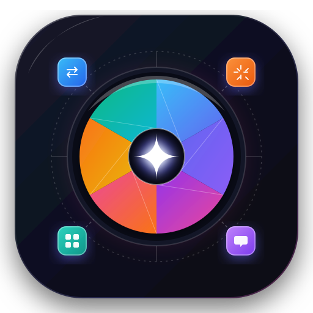

# PixelKit · Private In-Browser Photo Suite

<p align="center">
  
</p>

<p align="center">
  <strong>Fast, private, client-side photo and image tools that run entirely in your browser.</strong>
  <br>
  <em>No accounts · No uploads · No watermarks · Instant processing</em>
</p>

---

## 🧰 Included Tools

### 🔄 [Image Converter](tools/image-converter/index.html)
- Convert between **PNG, JPEG, WebP, AVIF, GIF, BMP, ICO, and TIFF**.
- Real-time side-by-side comparison slider with live preview.
- File size targeting (KB), dimensions scaling, and batch processing with ZIP export.

### 🎨 [Filter Studio](tools/filter-studio/index.html)
- Over **130+ professional filters** across 16 categories: *Cinematic, Film, Vintage, Duotone, Pop Art, Glitch, and more*.
- Filter stacking (layer up to 3 filters simultaneously).
- Interactive before/after split slider and granular parameter tuning.

### 🖼️ [Collage Maker](tools/collage-maker/index.html)
- Refined photo collage layouts for weddings, birthdays, travel, and social posts.
- Dynamic resizable grids, custom borders, aspect ratios, arches, and polaroid frames.
- Instant drag-and-drop cell organization.

### 🎭 [Meme Generator](tools/meme-generator/index.html)
- **169 original developer & tech memes** (git, deploys, debug life).
- **280+ popular classic & trending meme templates**.
- Custom image captions, draggable multi-line text, emoji stickers, and one-click copy to clipboard.

---

## 🔒 Privacy by Design

PixelKit runs **100% on the client side** using Web APIs (HTML5 Canvas, File API, Web Workers). Your images never leave your computer and are never uploaded to any server.

---

## 🚀 Getting Started

Simply open `index.html` in any modern web browser or serve locally:

```bash
# Using Python
python -m http.server 8000

# Using Node.js
npx serve .
```

---

## 🎨 Asset Information

- `assets/icon.svg`: Master scalable vector icon (Aperture Iris & Creative Pixel Matrix)
- `assets/favicon.svg`: Modern high-contrast vector favicon
- `assets/icon-512.png`: 512×512 App Icon
- `assets/icon-192.png`: 192×192 PWA / Android Icon
- `assets/apple-touch-icon.png`: 180×180 iOS Touch Icon
- `assets/og-image.png`: 1200×630 Open Graph & Social Preview Banner
- `favicon.ico`: Multi-size desktop browser icon (16×16, 32×32, 48×48)
